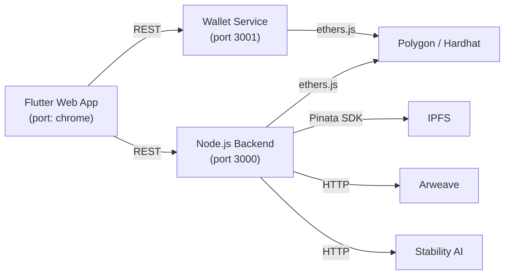
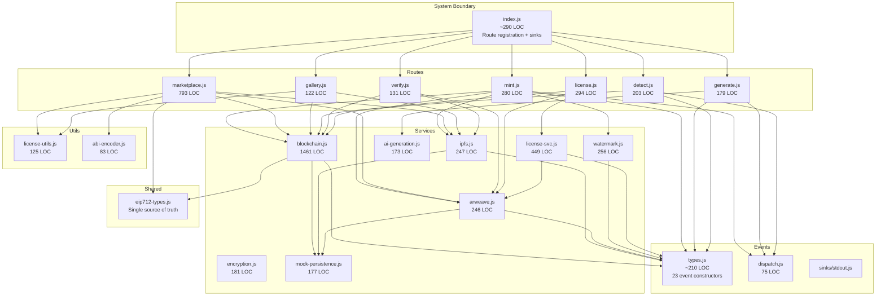
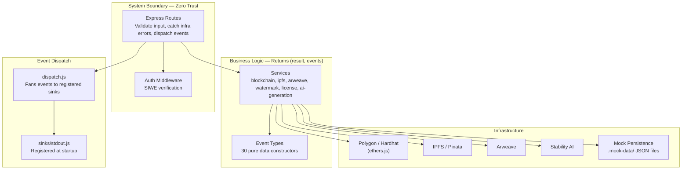
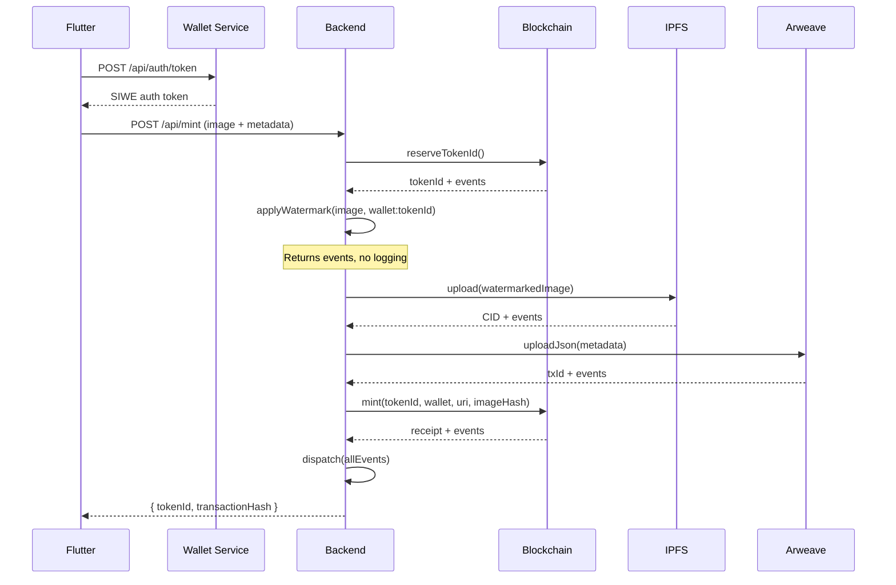
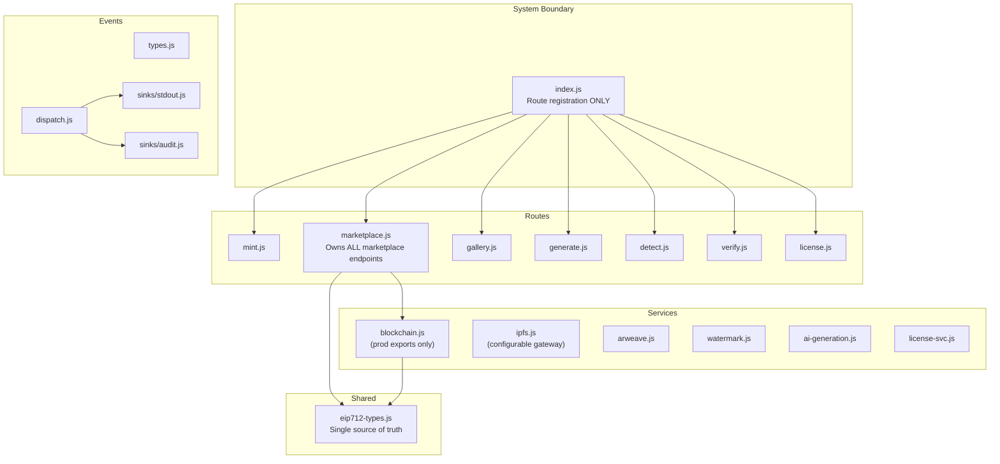

# Architecture — NFTmarket

> Generated by `/architecture-sweep` on 2026-04-29. Updated 2026-04-29.

## Overview

NFTmarket is an AI art marketplace combining invisible watermarking, NFT minting on Polygon, and legal licensing. Four components communicate via HTTP APIs and the Polygon blockchain:

**Flutter** → `NFTmarketNFT.sol` (UUPS upgradeable, bilateral EIP-712 signatures, backend-mediated)

## Section 1: Current Architecture

### Module Dependency Graph — Backend

### Layer Diagram

### Data Flow — Mint Operation

### Module Table

| Module | Interface (exports) | Implementation (LOC) | Depth | Issues |
|--------|-------------------|---------------------|-------|--------|
| `events/types.js` | 23 event constructors + `event` | ~210 | **Deep** | None — clean, pure data |
| `events/dispatch.js` | 5 functions | 75 | **Deep** | stdout sink registered at startup |
| `services/blockchain.js` | 36 functions | 1461 | **Deep** | Conflates prod + test exports; EIP-712 types via shared module |
| `services/ipfs.js` | 6 functions | 247 | **Deep** | Gateway URL configurable via `API_BASE_URL` |
| `services/arweave.js` | 9 functions | 246 | **Deep** | None |
| `services/watermark.js` | 2 functions | 256 | **Deep** | None |
| `services/license.js` | 6 functions | 449 | **Adequate** | Composes arweave (acceptable) |
| `services/encryption.js` | 2 functions | 181 | **Deep** | None |
| `services/ai-generation.js` | 5 functions | 173 | **Adequate** | Lazy require in setInterval |
| `middleware/auth.js` | 1 function | ~100 | **Deep** | Uses auth.verified/auth.failed events via dispatch |
| `routes/marketplace.js` | 1 router | ~770 | **Adequate** | EIP-712 types via shared module; owns all marketplace routes |
| `routes/mint.js` | 1 factory | 280 | **Adequate** | None |
| `index.js` | 1 app | ~290 | **Adequate** | Route registration + sink setup only |
| `services/perceptual.js` | 3 functions | 43 | — | Stub (used by mint.js) |

### Wallet Service Module Table

| Module | Interface | LOC | Depth | Issues |
|--------|-----------|-----|-------|--------|
| `services/accounts.js` | 5 functions | 123 | **Adequate** | Timer side effect on import; dead export `getPublicSession` |
| `services/signer.js` | 4 functions | 67 | **Deep** | Dead export `recoverAddress` |
| `services/blockchain.js` | 6 functions | 103 | **Deep** | Dead export `getChainId` |
| `middleware/session.js` | 1 function | 32 | **Deep** | None |
| `routes/auth.js` | 1 router | 70 | **Adequate** | Hardcoded `localhost` domain |

### Flutter Module Table

| Module | Interface | LOC | Depth | Issues |
|--------|-----------|-----|-------|--------|
| `services/api_service.dart` | 20+ methods | 550 | **Shallow** | God module — every API call in one class |
| `services/wallet_service.dart` | 10 methods | 301 | **Deep** | None |
| `providers/wallet_provider.dart` | 15+ properties/methods | 332 | **Adequate** | Fee simulation extracted to `fee_simulation_provider.dart` |
| `providers/mint_provider.dart` | 12 properties/methods | 142 | **Deep** | None |
| `pages/token_detail_page.dart` | 1 widget | 1229 | **Shallow** | 3 transaction flows + UI in one file |
| `pages/gallery_page.dart` | 1 widget | 973 | **Adequate** | License color duplication |
| `models/token.dart` | 3 types | 151 | **Deep** | None |

### Smart Contracts

| Contract | LOC | Type | Issues |
|----------|-----|------|--------|
| `NFTmarketNFT.sol` | ~800 | Production (UUPS) | None — well-structured |
| `NFTmarketPayments.sol` | ~120 | Production | None |
| `IERC721License.sol` | ~60 | Interface only | Not implemented by any contract |
| `NFTLicensingSystem.sol` | ~500 | Alternative/research | Clean but separate system |
| `TokenIdCodec.sol` | ~50 | Library | None |

---

## Section 2: Recommended Architecture

### Key Changes

### Changes from Current → Recommended

| # | Change | Principle | Effort | Status |
|---|--------|-----------|--------|--------|
| 1 | **Move marketplace endpoints from `index.js` into `marketplace.js`**. `index.js` should only register routes, not contain business logic. | Information hiding | S | **Done** |
| 2 | **Extract EIP-712 type definitions into `src/shared/eip712-types.js`**. Single source prevents drift between `blockchain.js` and `marketplace.js`. | Eliminate repetition | S | **Done** |
| 3 | **Register a stdout sink at startup**. The event system now produces structured output via `sinks/stdout.js`. | Complete the abstraction | S | **Done** |
| 4 | **Replace `console.log` in `auth.js` with events**. 17 log statements replaced with `auth.verified` / `auth.failed` events through dispatch. | Event-sink separation | S | **Done** |
| 5 | **Delete dead code: `firestore.js`, `storage.js`, `WalletProvider.tsx`**. `perceptual.js` retained (used by mint.js). | Complexity budget | S | **Done** |
| 6 | **Make `ipfs.js` gateway URL configurable**. Uses `API_BASE_URL` env var instead of hardcoded `localhost:3000`. | Information hiding | S | **Done** |
| 7 | **Separate `blockchain.js` test utilities from production exports**. Move `resetMock`, `getMockTokens` to a `blockchain.test-helpers.js`. | Information hiding | S | Remaining |
| 8 | **Extract `_getLicenseColor()` in Flutter** to `theme.dart` or a shared utility. Currently duplicated in 3 page files. | Eliminate repetition | S | Remaining |
| 9 | **Split `token_detail_page.dart`** (1229 LOC) — extract listing dialog + transaction flows into separate widgets/services. | One method, one complete job | M | Remaining |
| 10 | **Remove dead exports** from wallet service: `getPublicSession`, `recoverAddress`, `getChainId`. | Complexity budget | S | Remaining |

---

## Architectural Strengths

1. **Event system design** — `events/types.js` + `events/dispatch.js` is a textbook comonoid: pure data events, fan-out dispatch, sink isolation. The 23 event constructors cover the full domain.

2. **Mock mode consistency** — Every service supports mock mode via environment variables with a uniform pattern. Tests exercise the full stack with mock backends rather than jest.mock, producing realistic coverage.

3. **Wallet isolation** — Private keys never leave the wallet service. Flutter communicates via session-based REST, never holding key material. The 4-step blockchain flow (prepare → sign → encode → send) maintains this boundary cleanly.

4. **Service tuple returns** — Services return `[result, events]` tuples, keeping side effects out of business logic. Routes accumulate events and dispatch once at the end.

5. **Smart contract security** — UUPS proxy, reentrancy guards, bilateral EIP-712 signatures, duplicate prevention via image hash, auto-delist on transfer. The license hierarchy is enforced on-chain.

## Architectural Weaknesses

1. **`blockchain.js` conflates prod and test exports** — `resetMock`, `getMockTokens` are exported alongside production functions. Should be separated into test-helpers.

2. **Flutter `token_detail_page.dart`** (1229 LOC) — Three transaction flows plus full UI in one file. Should be split into separate widgets/services.

3. **License color function duplicated** — `_getLicenseColor()` appears in 3 Flutter page files.
